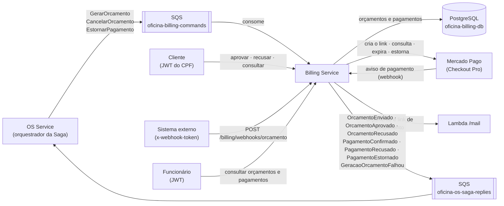
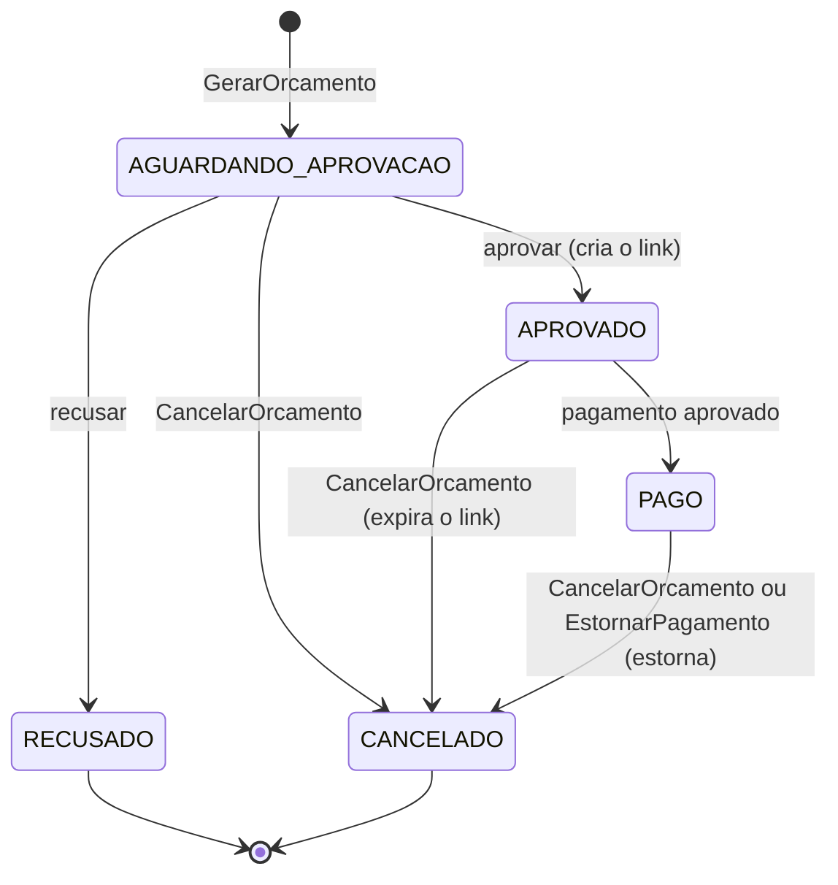
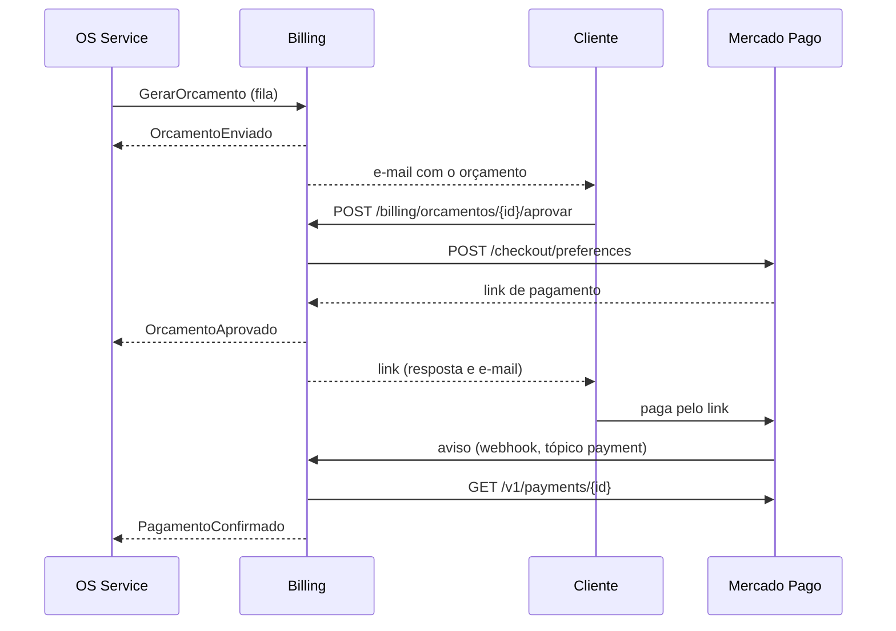

# Billing Service

Orçamentos, aprovação e pagamentos com o Mercado Pago.

Microsserviço do Tech Challenge da Fase 4 (FIAP SOAT). A oficina mecânica foi dividida em três serviços: OS Service, Billing Service e Execution Service. A Saga é orquestrada pelo OS Service. Os contratos de mensagens e rotas entre os serviços estão em [docs/contratos.md](https://github.com/LucasValada/tech-challenge-fiap/blob/develop/docs/contratos.md), e este serviço segue esse documento à risca.

| Serviço | Repositório | Banco |
|---|---|---|
| OS Service (orquestrador da Saga) | [LucasValada/tech-challenge-fiap](https://github.com/LucasValada/tech-challenge-fiap) | PostgreSQL |
| Billing Service | [oficina-billing-service](https://github.com/fiap-soat-oficina-tech-challenge/oficina-billing-service) | PostgreSQL |
| Execution Service | [oficina-execution-service](https://github.com/fiap-soat-oficina-tech-challenge/oficina-execution-service) | DynamoDB |

## Sumário

- [Responsabilidades](#responsabilidades)
- [Como funciona](#como-funciona)
- [Ciclo do orçamento e do pagamento](#ciclo-do-orçamento-e-do-pagamento)
- [Fluxos da Saga](#fluxos-da-saga)
- [Mensagens](#mensagens)
- [API REST](#api-rest)
- [Integração com o Mercado Pago](#integração-com-o-mercado-pago)
- [Garantias](#garantias)
- [Modelo de dados](#modelo-de-dados)
- [Arquitetura do código](#arquitetura-do-código)
- [Tecnologias](#tecnologias)
- [Rodando localmente](#rodando-localmente)
- [Testes e cobertura](#testes-e-cobertura)
- [Variáveis de ambiente](#variáveis-de-ambiente)
- [Deploy](#deploy)
- [Fluxo de trabalho](#fluxo-de-trabalho)
- [Decisões e limites](#decisões-e-limites)

## Responsabilidades

- Gerar o orçamento da OS e enviá-lo ao cliente para aprovação
- Registrar a aprovação ou a recusa, feita pelo cliente ou pelo sistema externo
- Cobrar pelo Mercado Pago (Checkout Pro), confirmar os pagamentos e estornar quando a Saga precisa compensar
- Avisar a Saga de cada resultado: orçamento enviado, aprovado ou recusado, e pagamento confirmado, recusado ou estornado

O serviço **não** muda o status da OS. Ele só avisa o OS Service, e o orquestrador decide.

## Como funciona



1. Quando o mecânico conclui o diagnóstico, o OS Service publica `GerarOrcamento` com uma cópia das linhas da OS (serviços e itens, com os preços daquele momento). O Billing cria o orçamento, responde `OrcamentoEnviado` e manda o orçamento por e-mail ao cliente.
2. O cliente aprova ou recusa pela API, com o token do CPF. O sistema externo também pode decidir, pelo webhook. Na aprovação, o Billing cria o link de pagamento no Mercado Pago, devolve o link na resposta e o envia por e-mail.
3. O cliente paga pelo link. O Mercado Pago avisa o webhook do Billing, que consulta o pagamento na API do Mercado Pago e responde `PagamentoConfirmado` ou `PagamentoRecusado`.
4. Se a Saga precisar desfazer, o OS Service manda `CancelarOrcamento` (o cliente ainda não pagou) ou `EstornarPagamento` (o reparo falhou depois do pagamento).

## Ciclo do orçamento e do pagamento



As transições ficam em [`domain/orcamento.ts`](src/modules/orcamento/domain/orcamento.ts). Ação fora do ciclo, como aprovar um orçamento já recusado, responde 409 e não publica nada.

Cada pagamento informado pelo Mercado Pago vira um registro, identificado pelo id do próprio Mercado Pago:

| Status | Quando |
|---|---|
| `APROVADO` | pagamento aprovado que quitou o orçamento |
| `RECUSADO` | tentativa recusada (cartão negado, por exemplo); fica no histórico |
| `ESTORNADO` | devolvido ao cliente, seja por compensação da Saga, seja porque chegou depois do cancelamento |

## Fluxos da Saga

Caminho feliz, do ponto de vista do Billing:



O que o Billing faz em cada falha. A coluna **Compensação** é o que acontece aqui; a compensação no OS (devolver estoque e cancelar a OS) está em `docs/contratos.md`.

| Situação | Quem detecta | O Billing faz | Responde |
|---|---|---|---|
| OS sem serviços nem itens | Billing, no `GerarOrcamento` | não cria o orçamento | `GeracaoOrcamentoFalhou` (`ORCAMENTO_VAZIO`) |
| Comando com dados inválidos ou totais que não fecham | Billing, no `GerarOrcamento` | não cria o orçamento | `GeracaoOrcamentoFalhou` (`COMANDO_INVALIDO: ...`) |
| Cliente ou sistema externo recusa | Billing | marca `RECUSADO` | `OrcamentoRecusado` |
| Mercado Pago fora na aprovação | Billing | nada muda; a rota responde 503 | — |
| Pagamento recusado | Mercado Pago | registra a tentativa | `PagamentoRecusado` |
| OS cancelada esperando o cliente | OS (`CancelarOrcamento`) | cancela; se já havia link, **expira o link**; se já estava pago, **estorna** | `PagamentoEstornado`, só se estornou |
| Reparo falhou depois do pagamento | OS (`EstornarPagamento`) | **estorna** e cancela o orçamento | `PagamentoEstornado` |
| Pagamento aprovado depois do cancelamento | Mercado Pago | **estorna** | `PagamentoEstornado` |

Nenhuma OS cancelada fica com dinheiro retido: o pagamento é estornado pelo caminho que chegar primeiro.

## Mensagens

Formato do envelope e payloads em `docs/contratos.md`, seções 3 e 5.

**Consome** (fila `oficina-billing-commands`):

| Comando | Caso de uso |
|---|---|
| `GerarOrcamento` | [`gerar-orcamento.use-case.ts`](src/modules/orcamento/application/use-case/gerar-orcamento.use-case.ts) |
| `CancelarOrcamento` | [`cancelar-orcamento.use-case.ts`](src/modules/orcamento/application/use-case/cancelar-orcamento.use-case.ts) |
| `EstornarPagamento` | [`estornar-pagamento.use-case.ts`](src/modules/orcamento/application/use-case/estornar-pagamento.use-case.ts) |

Um tipo desconhecido é descartado com um log de aviso.

**Publica** (fila `oficina-os-saga-replies`). Toda resposta leva o `osId` e o `correlationId` do fluxo da OS, que ficam guardados no orçamento:

| Resposta | Quando | `payload` |
|---|---|---|
| `OrcamentoEnviado` | orçamento criado | `{ orcamentoId, valorTotal }` |
| `GeracaoOrcamentoFalhou` | comando sem linhas ou inválido | `{ motivo }` |
| `OrcamentoAprovado` | aprovação do cliente ou do sistema externo | `{ orcamentoId, origem }` |
| `OrcamentoRecusado` | recusa | `{ orcamentoId, origem, motivo }` |
| `PagamentoConfirmado` | pagamento aprovado no Mercado Pago | `{ pagamentoId, valor, pagoEm }` |
| `PagamentoRecusado` | pagamento recusado no Mercado Pago | `{ detalhe }` |
| `PagamentoEstornado` | estorno feito | `{ pagamentoId, estornadoEm }` |

## API REST

Prefixo `/billing`. A documentação interativa (Swagger) fica em `/billing/api`.

| Método e rota | Quem chama | O que faz |
|---|---|---|
| `GET /billing/orcamentos?osId={osId}` | funcionário ou cliente dono | Lista os orçamentos da OS (no máximo um). O cliente só vê o próprio; para os outros, a lista vem vazia |
| `GET /billing/orcamentos/{id}` | funcionário ou cliente dono | Consulta um orçamento; depois da aprovação, inclui `linkPagamento` e `linkExpiraEm`. Orçamento de outro cliente é 404 |
| `POST /billing/orcamentos/{id}/aprovar` | cliente dono | Aprova, cria o link no Mercado Pago e devolve o orçamento com o `linkPagamento`. 409 se não estiver aguardando aprovação; 503 se o Mercado Pago falhar (nada muda) |
| `POST /billing/orcamentos/{id}/recusar` | cliente dono | Recusa, com `{ motivo }` opcional |
| `POST /billing/webhooks/orcamento` | sistema externo (`x-webhook-token`) | Aprovação externa: `{ codigoOS, aprovado, motivo? }`. É o mesmo corpo do webhook do OS na Fase 3; só a URL mudou |
| `POST /billing/webhooks/mercado-pago` | Mercado Pago (rota pública) | Aviso de pagamento. Responde `{ resultado }`: `PAGAMENTO_CONFIRMADO`, `PAGAMENTO_RECUSADO`, `PAGAMENTO_ESTORNADO`, `JA_PROCESSADO` ou `IGNORADO` |
| `GET /billing/pagamentos?osId={osId}` | funcionário | Pagamentos, tentativas recusadas e estornos da OS |
| `GET /billing/health` e `/billing/health/ready` | Kubernetes e ALB | Liveness (o processo responde) e readiness (o banco responde) |

O serviço não emite token. Ele valida o mesmo JWT do OS Service (funcionário, login por e-mail) e da Lambda de autenticação (cliente, por CPF), com o segredo `JWT_SECRET`. Sem `@Roles` na rota, só o funcionário passa.

## Integração com o Mercado Pago

O produto é o **Checkout Pro**, em sandbox. O adaptador está em [`infra/mercado-pago/mercado-pago.gateway.ts`](src/modules/orcamento/infra/mercado-pago/mercado-pago.gateway.ts) e usa a API REST direto, com `fetch` e sem SDK:

| Operação | Chamada | Quando |
|---|---|---|
| Criar o link | `POST /checkout/preferences` com `external_reference` = id do orçamento, `notification_url` e prazo (`expiration_date_to`, 72 h) | na aprovação |
| Consultar o pagamento | `GET /v1/payments/{id}` | a cada aviso do webhook |
| Expirar o link | `PUT /checkout/preferences/{id}` com o prazo no passado | `CancelarOrcamento` com o orçamento aprovado |
| Estornar | `POST /v1/payments/{id}/refunds` com `X-Idempotency-Key: estorno-{id}` | compensações |

Como o adaptador se protege:

- **O aviso nunca é a fonte da verdade.** O webhook só traz o id do pagamento. Situação, valor e orçamento vêm da consulta à API, então um aviso forjado não confirma pagamento nenhum. Por isso a rota pode ser pública.
- **Timeout e nova tentativa.** Cada chamada tem timeout de 10 s e uma nova tentativa em erro de rede, 429 ou 5xx. O pior caso (cerca de 20 s) fica abaixo dos 30 s do API Gateway e dos 60 s de visibilidade da fila. Erro 4xx não é repetido, porque repetir não resolve.
- **Estorno idempotente.** A chave de idempotência é fixa por pagamento. Se o estorno for repetido (a gravação falhou depois do estorno e a mensagem voltou para a fila), o Mercado Pago não devolve o dinheiro duas vezes.
- **Pagamento desconhecido.** Um id que o Mercado Pago não conhece, como o aviso de teste do painel, é ignorado com 200, para não ser reenviado à toa.

O Mercado Pago não avisa quando um link expira. Por isso uma OS parada esperando pagamento é cancelada pelo funcionário no OS Service, e o cancelamento chega aqui como `CancelarOrcamento`.

Localmente e nos testes, a API é substituída pelo [simulador](mercado-pago-simulador/README.md) (WireMock), apontado por `MERCADO_PAGO_API_URL`. O código é o mesmo.

## Garantias

- **Banco próprio.** Orçamentos e pagamentos ficam no PostgreSQL deste serviço. O cliente e as linhas chegam no comando, e o serviço nunca consulta o banco do OS Service.
- **Comando repetido não duplica nada.** O SQS entrega cada mensagem pelo menos uma vez, então o serviço confere o estado e usa chaves naturais (`docs/contratos.md`, seção 1):
  - uma OS tem um só orçamento (`osId` único), então um `GerarOrcamento` repetido é ignorado;
  - um pagamento é registrado uma vez (a chave é o id do Mercado Pago), então um aviso repetido responde `JA_PROCESSADO`;
  - um pagamento só é estornado se ainda estiver `APROVADO`, então um `EstornarPagamento` repetido não faz nada;
  - um `CancelarOrcamento` para orçamento já `RECUSADO` ou `CANCELADO` não faz nada.
- **Gravar e publicar na mesma transação.** Quem grava e publica faz as duas coisas dentro de uma transação do banco, publicando antes do commit ([`domain/repository/transacao.ts`](src/modules/orcamento/domain/repository/transacao.ts)). Se a publicação falha, nada fica gravado. É a alternativa enxuta ao outbox transacional, definida nos contratos.
- **Chamadas externas fora da transação.** O Mercado Pago é chamado antes da transação. Assim, uma conexão do banco nunca fica presa esperando a rede, e uma falha do Mercado Pago não deixa nada pela metade.
- **Concorrência otimista.** Toda mudança de status grava com o status lido no filtro (`UPDATE ... WHERE status = <lido>`). Se outra ação chegou antes (um pagamento no meio de um cancelamento, por exemplo), a gravação não acontece. A rota responde 409, e a mensagem ou o aviso é processado de novo, já vendo o estado novo.
- **Falha de negócio vira resposta; falha técnica vira nova tentativa.** Um comando sem linhas responde `GeracaoOrcamentoFalhou`, para o orquestrador compensar. Banco ou Mercado Pago fora devolve a mensagem para a fila: depois de 5 tentativas ela vai para a DLQ `oficina-billing-commands-dlq`, então uma compensação nunca se perde.
- **E-mail é best-effort.** Falha no envio só vai para o log e nunca desfaz a operação, como na Fase 3.
- **Rastreamento.** As linhas de log do consumo de mensagens levam o `correlationId` e o `osId` do envelope, os mesmos do OS e do Execution, e é por eles que se acompanha uma OS nos três serviços no New Relic. Nas rotas HTTP, o `correlationId` da linha é o da requisição (header `x-correlation-id`), e os eventos de negócio levam o `os_id`. As respostas publicadas a partir de uma rota HTTP levam o `correlationId` do fluxo, guardado no orçamento.

## Modelo de dados

Schema em [`prisma/schema.prisma`](prisma/schema.prisma); migrations em `prisma/migrations/`.

| Tabela | Conteúdo | Chaves e índices |
|---|---|---|
| `Orcamento` | OS (id e código), `correlationId` do fluxo, cliente (cópia), totais, status, decisão (origem e motivo), cobrança (preferência, link e prazo), datas de cada etapa | `id`; `osId` e `codigoOS` únicos; índice por `clienteId` |
| `LinhaOrcamento` | serviços e itens do orçamento (`tipo`), com nome, preço unitário, quantidade e subtotal da época, na ordem em que chegaram | índice por `orcamentoId` |
| `Pagamento` | pagamentos informados pelo Mercado Pago: status, valor, `status_detail`, datas e motivo do estorno | `id` = id do Mercado Pago; índices por `osId` e `orcamentoId` |

**Por que PostgreSQL.** Orçamento e pagamento são dinheiro, e o serviço precisa de:

- transação de verdade: o orçamento, as linhas e a publicação da resposta se confirmam juntos;
- chaves únicas que garantem a idempotência (um orçamento por OS, um registro por pagamento);
- gravação condicional pelo status;
- valores decimais exatos.

O banco relacional dá tudo isso, e é o mesmo motor e a mesma ferramenta (Prisma) do OS Service. O NoSQL do projeto fica no Execution, onde os dados são documentos simples por chave.

Valores em `Decimal(10, 2)`, como no OS Service. No código, as contas de dinheiro são feitas em centavos inteiros ([`domain/dinheiro.ts`](src/modules/orcamento/domain/dinheiro.ts)) para evitar erro de ponto flutuante. O `GerarOrcamento` só é aceito se cada subtotal for preço × quantidade e os totais fecharem com a soma das linhas.

## Arquitetura do código

Arquitetura limpa, no mesmo padrão de módulos do OS Service (`domain`, `application`, `infra`, `interface`). Os casos de uso dependem só de **portas** (interfaces), e as implementações concretas (Prisma, SQS, Mercado Pago, Lambda de e-mail) são ligadas no módulo do Nest. Por isso os testes dos casos de uso rodam com dublês em memória, sem banco nem rede.

```
src/
  common/
    aws/              cliente do SQS
    mensageria/       envelope, consumidor SQS (long polling, só apaga depois de processar) e publicador
    observability/    New Relic, eventos de log e contexto do fluxo (correlationId do envelope)
    guards/           JWT com papéis e token do webhook externo
  core/config/        validação das variáveis de ambiente e prefixo das rotas
  modules/
    prisma/           conexão com o PostgreSQL (TLS com a CA do RDS)
    health/           liveness e readiness (SELECT 1)
    orcamento/
      domain/         Orcamento, Pagamento, ciclo de status, dinheiro, erros e portas de persistência
      application/
        ports/        portas: publicador de respostas, gateway de pagamento, notificador
        use-case/     um caso de uso por comando ou ação (gerar, decidir, processar aviso, cancelar, estornar, consultar)
        shared/       estorno de pagamento (usado em três fluxos), leitura e validação do comando, erros → HTTP
        dto/          entradas e respostas da API (Swagger)
      infra/
        prisma/       repositórios e transação no PostgreSQL
        mercado-pago/ adaptador da API do Mercado Pago
        notificacao/  e-mails pela Lambda /mail
      interface/
        controller/   rotas de orçamentos, pagamentos e webhooks
        consumer/     consumidor da fila de comandos (um caso de uso por tipo)
        presenter/    formato do orçamento nas respostas
prisma/               schema e migrations
k8s/                  namespace, ConfigMap, Job de migração, Deployment, Service, HPA, Ingress e PDB
terraform/            fila, DLQ, RDS, ECR e permissões
localstack/           criação das filas no LocalStack
mercado-pago-simulador/  respostas simuladas da API do Mercado Pago (WireMock)
scripts/              teste de ponta a ponta
```

A base comum (`common/`, `core/`, `auth`, `health`) é a mesma nos três serviços. Mudanças nela devem ser feitas nos três.

## Tecnologias

NestJS 11 · TypeScript · Node.js 24 · PostgreSQL 17 (Amazon RDS) · Prisma 7 · Amazon SQS · AWS SDK v3 · Mercado Pago (Checkout Pro, API REST) · Jest · logs JSON com `nestjs-pino` e `correlationId` · agente New Relic · Docker · LocalStack · WireMock · Kubernetes (EKS) · Terraform · GitHub Actions

## Rodando localmente

Com Docker, o compose sobe o PostgreSQL, o SQS (LocalStack) e o simulador do Mercado Pago, aplica as migrations e inicia o serviço:

```bash
cp .env.example .env    # ajuste JWT_SECRET para o mesmo segredo do OS Service
docker compose up --build
```

- Saúde: `http://localhost:3001/billing/health/ready`
- Swagger: `http://localhost:3001/billing/api`

Sem Docker para o serviço (as dependências ainda são necessárias): `docker compose up -d postgres localstack mercado-pago`, depois `npm ci && npx prisma generate && npx prisma migrate deploy && npm run start:dev` (porta 3000).

### Teste de ponta a ponta

Com o compose no ar, [`scripts/teste-ponta-a-ponta.sh`](scripts/teste-ponta-a-ponta.sh) faz o papel do OS Service: publica comandos na fila, lê as respostas da Saga e chama as rotas como cliente, funcionário, sistema externo e Mercado Pago.

```bash
bash scripts/teste-ponta-a-ponta.sh
```

São 37 verificações em cinco cenários:

1. caminho feliz até o estorno: orçamento, aprovação, pagamento e falha no reparo;
2. recusa pelo cliente;
3. aprovação externa, pagamento recusado e cancelamento com o link expirado;
4. pagamento que chega depois do cancelamento e é estornado;
5. OS sem linhas, Mercado Pago fora na aprovação e aviso de pagamento desconhecido.

O script também confere a idempotência: comando repetido, aviso repetido e estorno repetido.

## Testes e cobertura

```bash
npm test            # testes unitários
npm run test:cov    # com cobertura; falha abaixo de 80% de linhas e instruções
```

Resultado atual: **218 testes, 97% de linhas** (97,0% de instruções, 84,9% de branches, 98,1% de funções).

| Camada | O que os testes cobrem |
|---|---|
| Domínio | ciclo do orçamento (transições válidas e recusadas) e contas em centavos |
| Casos de uso | cada fluxo da tabela [Fluxos da Saga](#fluxos-da-saga), com dublês em memória que reproduzem o banco (rollback quando a transação falha, chave única e gravação condicional): idempotência, corridas (pagamento × cancelamento), falha na publicação, Mercado Pago fora |
| Infraestrutura | chamadas ao Mercado Pago (corpo, headers, timeout e novas tentativas), e-mails, mapeamento do Prisma |
| Interface | rotas, leitura do aviso do Mercado Pago nos formatos webhook e IPN, e roteamento dos comandos |

O CI (`.github/workflows/ci.yml`) roda lint, testes com cobertura e build em todo PR; o check `Build & Test` é obrigatório para o merge na `main`.

## Variáveis de ambiente

| Variável | Uso |
|---|---|
| `JWT_SECRET` | Mesmo segredo do OS Service e da Lambda de autenticação |
| `WEBHOOK_ORCAMENTO_TOKEN` | Token do sistema externo de aprovação (header `x-webhook-token`) |
| `DATABASE_URL` | PostgreSQL do Billing |
| `AWS_REGION` | Região da AWS |
| `BILLING_COMMANDS_QUEUE_URL` | Fila consumida |
| `SAGA_REPLIES_QUEUE_URL` | Fila das respostas para o orquestrador |
| `MERCADO_PAGO_ACCESS_TOKEN` | Access Token (de teste) da aplicação do Checkout Pro |
| `MERCADO_PAGO_API_URL` | Opcional. Padrão: `https://api.mercadopago.com`; nos testes, o simulador |
| `MERCADO_PAGO_NOTIFICATION_URL` | Opcional. URL pública do webhook; sem ela, o Mercado Pago não avisa os pagamentos |
| `MERCADO_PAGO_SANDBOX` | `true` (padrão) devolve o link de sandbox; `false`, o de produção |
| `MAIL_LAMBDA_URL` e `MAIL_LAMBDA_TOKEN` | Opcionais. Lambda de e-mail; sem elas, nenhum e-mail é enviado |
| `AWS_ENDPOINT_URL` | Só localmente: aponta para o LocalStack |

## Deploy

Os manifestos ficam em `k8s/`, no namespace `oficina-billing`. A ordem de aplicação acompanha a numeração dos arquivos: ConfigMap, Job de migração (`prisma migrate deploy`, que precisa terminar antes), Deployment, Service, HPA, Ingress e PDB. O Ingress compartilha o ALB dos três serviços (`group.name: oficina`) e encaminha `/billing` para este serviço. Os segredos chegam pelo Secret `billing-secret`, montado a partir do SSM. A lista está em [`terraform/README.md`](terraform/README.md). O pipeline de deploy no EKS entra na etapa de integração do plano de ação.

A infraestrutura AWS do serviço (fila, banco, repositório de imagens e permissões) está em [`terraform/`](terraform/README.md).

## Fluxo de trabalho

- Branch a partir da `develop` → PR para a `develop` → PR da `develop` para a `main`.
- A `main` é protegida: exige PR com uma aprovação, o check `Build & Test` verde e a branch atualizada, e vale também para administradores.
- Mudança de contrato (mensagem, fila ou rota usada por outro serviço) começa por um PR em `docs/contratos.md` no OS Service, e só depois é feita nos serviços.
- Mudança na base comum (`src/common/`, `src/core/`, `auth`, `health`) é feita nos três serviços.

## Decisões e limites

- **Um orçamento por OS.** Recusa e cancelamento encerram a OS na Saga, então nunca há um segundo orçamento. O `osId` único é a chave da idempotência do `GerarOrcamento`.
- **A cobrança só existe depois da aprovação.** O link é criado na aprovação, e não junto com o orçamento: o cliente não recebe cobrança de algo que ainda não aceitou.
- **Pagamento recusado encerra a OS.** No Checkout Pro, o cliente poderia tentar de novo com outro cartão, mas o contrato da Saga cancela a OS na primeira recusa. Por isso o `CancelarOrcamento` expira o link. Um pagamento aprovado que ainda chegue depois disso é estornado.
- **Link criado e não usado.** Se a gravação da aprovação falhar depois de o link ser criado no Mercado Pago, o link fica sem uso: ninguém o recebe, e ele expira no prazo. Não há compensação para isso porque não há cobrança.
- **Assinatura do webhook do Mercado Pago não é validada.** A segurança vem da consulta do pagamento na API, que é a regra do contrato. A validação do header `x-signature` ficaria como extra.
- **Sem tabela de mensagens processadas e sem outbox.** A idempotência vem do estado e das chaves naturais, e a consistência entre gravar e publicar vem da publicação dentro da transação, como definido nos contratos.
